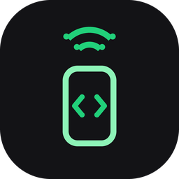
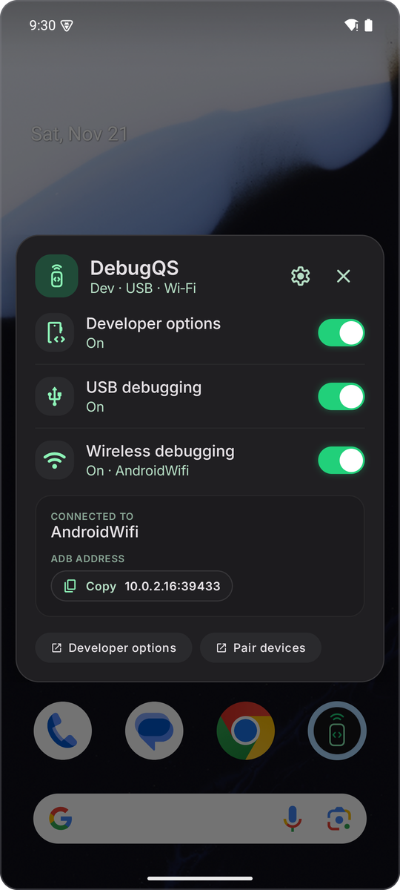
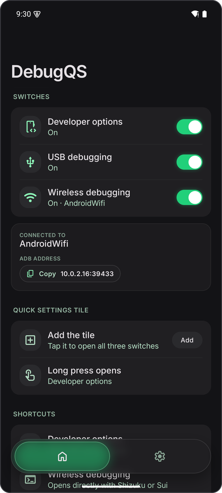
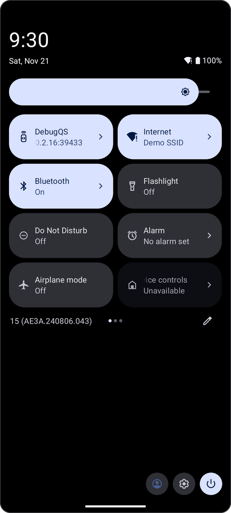
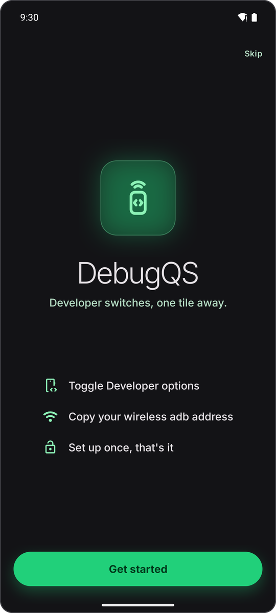
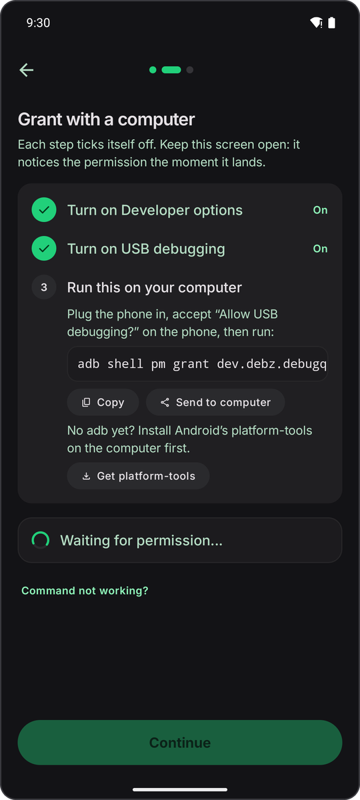
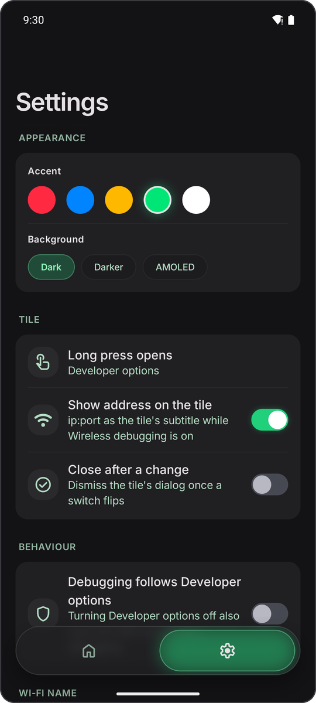

<p align="center">
  
</p>

<h1 align="center">DebugQS</h1>

<p align="center">
  Developer options, USB debugging and Wireless debugging, all behind one Quick Settings tile.
</p>

<p align="center">
  <a href="https://github.com/Redfox-OSS/DebugQS/releases/latest"></a>
  
  <a href="LICENSE"></a>
</p>

---

Banking and payment apps often refuse to run while Developer options are on. Turning them off in
Settings resets every developer setting you've changed, and turning them back on means tapping
Build number seven times again.

DebugQS fixes that. Tap one tile to get a small panel with all three switches. Flip Developer
options off for the picky app and back on afterwards; nothing else gets reset.

## Screenshots

<table>
  <tr>
    <td align="center"></td>
    <td align="center"></td>
    <td align="center"></td>
  </tr>
  <tr>
    <td align="center"><sub>Tap the tile: every switch in one panel</sub></td>
    <td align="center"><sub>The app: switches, Wi‑Fi and shortcuts</sub></td>
    <td align="center"><sub>The tile shows what's on, or the adb address</sub></td>
  </tr>
  <tr>
    <td align="center"></td>
    <td align="center"></td>
    <td align="center"></td>
  </tr>
  <tr>
    <td align="center"><sub>First launch</sub></td>
    <td align="center"><sub>Guided setup that ticks itself off</sub></td>
    <td align="center"><sub>Accent, background and tile options</sub></td>
  </tr>
</table>

## Features

- **One tile, three switches.** Tap the DebugQS tile for a panel with Developer options, USB
  debugging and Wireless debugging. It updates live, even when something else changes a setting.
- **Wireless debugging, ready to use.** While it's on, the panel shows the Wi‑Fi network you're on
  and the `adb connect` address (IP and port) with a copy button.
- **A tile that tells you something.** It's lit while Developer options are on, and its subtitle
  shows what's on (`Dev · USB · Wi‑Fi`) or the adb address.
- **Long press** opens Developer options, the Wireless debugging page, or the app (your choice).
- **Guided setup.** First launch walks you through granting the one permission DebugQS needs. Each
  step ticks itself off, and the grant is detected automatically.
- **Optional extras:** turn debugging off together with Developer options, close the panel after a
  change, and pick an accent and background shade.
- **Shizuku and Sui support.** Grant the permission without a computer, open the Wireless debugging
  page directly, and keep the Developer options page working after switching it back on.
- **No accounts, no ads, no tracking.** DebugQS doesn't use the internet. It only looks for the
  wireless debugging service on your local network.

## Install

1. Download the latest `DebugQS-<version>.apk` from
   [Releases](https://github.com/Redfox-OSS/DebugQS/releases/latest) and install it.
2. Open DebugQS and follow the setup. It covers the two steps below.

Requires Android 12 or newer.

## Granting the permission

Android only lets an app change these settings with `WRITE_SECURE_SETTINGS`. Regular apps can't
request it; you grant it once and it stays until you uninstall.

**With a computer (recommended).** Turn on USB debugging, connect the phone, accept the prompt on
the phone, then run:

```bash
adb shell pm grant dev.debz.debugqs android.permission.WRITE_SECURE_SETTINGS
```

No `adb` yet? Get Google's
[platform-tools](https://developer.android.com/tools/releases/platform-tools).

**With Shizuku.** If [Shizuku](https://shizuku.rikka.app/) (or Sui on a rooted phone) is
running, choose *With Shizuku* during setup and tap *Allow*. DebugQS grants itself the permission.

<details>
<summary>Command not working?</summary>

- **`device unauthorized`**: unplug, plug back in and accept "Allow USB debugging?" on the phone.
- **Xiaomi, Redmi, POCO**: also turn on *USB debugging (Security settings)* in Developer options.
- **`no devices`**: try another cable or port, and pick *File transfer* in the USB notification.

</details>

## Using it

1. Add the tile. The setup's last step does it in one tap, or edit Quick Settings and drag
   *DebugQS* in.
2. **Tap** the tile for the panel; **long press** it for Developer options (or whatever you picked
   in Settings).
3. Need the Wi‑Fi name? Android only reveals it to apps with location access. Allow it from
   *Settings › Wi‑Fi name*, or run Shizuku. DebugQS never uses your location for anything else.

> [!NOTE]
> Turning on Wireless debugging on a new network shows Android's own "Allow on this network?"
> prompt. That's the system, not DebugQS.

## Building

Requires JDK 17+ and the Android SDK (compile SDK 36.1).

```bash
./gradlew assembleDebug        # app/build/outputs/apk/debug/app-debug.apk
./gradlew check                # lint and the Obsidian design-rule check
```

Release builds are signed with a key that's never stored in the repository. To sign your own,
add these to `~/.gradle/gradle.properties`:

```properties
DEBUGQS_STORE_FILE=/path/to/release.jks
DEBUGQS_STORE_PASSWORD=…
DEBUGQS_KEY_ALIAS=…
DEBUGQS_KEY_PASSWORD=…
```

then run `./gradlew assembleRelease`. Without them, the release build is left unsigned.

**Stack:** Kotlin, Jetpack Compose, Navigation 3, the [Obsidian](https://github.com/Redfox-OSS/obsidian)
design system, and the [Shizuku API](https://github.com/RikkaApps/Shizuku-API).

## Credits

- [DevQS](https://github.com/louie-velarde/DevQS) by Louie Velarde, which introduced the three
  separate tiles this app combines into one. Parts of DebugQS's settings, Shizuku and wireless
  debugging logic are adapted from it (MIT, see [NOTICE](NOTICE)).
- [Obsidian](https://github.com/Redfox-OSS/obsidian), the design system the UI is built on
  (Apache 2.0).

## License

DebugQS is licensed under the [GNU General Public License v3.0](LICENSE).
